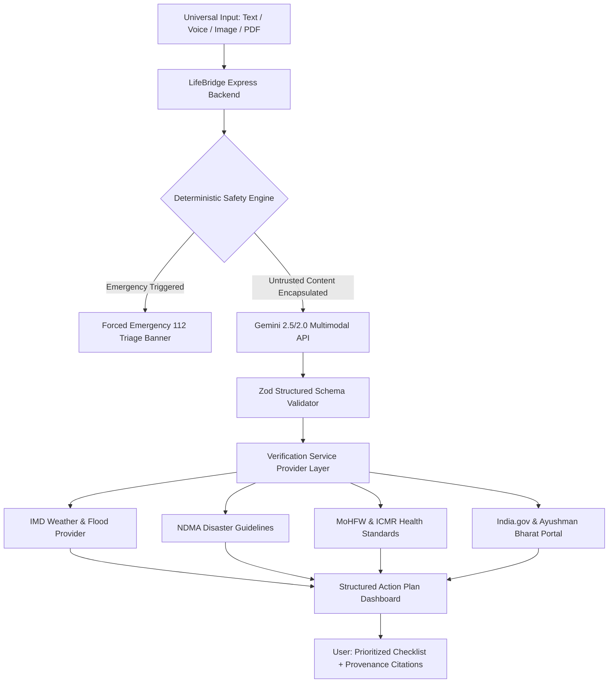

# 🛡️ LifeBridge AI — Universal Public Assistance Platform

> **Gemini-Powered Universal Public Assistance & Decision Support Engine**  
> Transforms chaotic real-world inputs (unstructured text, voice notes, confusing medical lab reports, flood alerts, road accident photos) into verified, structured, prioritized action plans.

---

## 🌟 Executive Summary

In moments of crisis or civic uncertainty, people struggle to navigate fragmented government portals, complex medical reports, and urgent situations. **LifeBridge AI** solves this through a single universal interface:

$$\text{Messy Input} \longrightarrow \text{Gemini AI Multimodal Reasoning} \longrightarrow \text{Structured Facts} \longrightarrow \text{Verification Layer} \longrightarrow \text{Prioritized Action Plan}$$

---

## 🚀 Key Highlights & Hackathon Features

| Feature | Implementation Details |
|---|---|
| **Intelligent Universal Input** | Natural language text, live microphone voice recording (Web Audio API / MediaRecorder), image uploads (prescriptions, damage photos), and PDF reports. |
| **Google Gemini Multimodal AI** | Powered by the official `@google/genai` SDK with strict JSON Schema output validation via **Zod**. |
| **Deterministic Emergency Triage** | Independent safety rules on the backend that force `urgency: emergency` on cardiac symptoms, trauma, or active floods, surfacing **112 / 108 direct-dial shortcuts** without waiting for LLM completion. |
| **Trusted Verification Layer** | Dedicated provider abstraction cross-referencing claims against authoritative sources: **India Meteorological Department (IMD)**, **National Disaster Management Authority (NDMA)**, **Ministry of Health & Family Welfare (MoHFW)**, **MoRTH**, and **India.gov.in**. |
| **Interactive Action Plan** | Numbered checklist prioritized by urgency (Priority 1, 2, 3), with "Why this matters" rationales, official links, and human-confirmation indicators. |
| **Zero-Retention Privacy** | Uploaded documents and raw audio are processed strictly in RAM/ephemeral memory and purged immediately. API keys remain exclusively on the server. |
| **1-Click Hackathon Demo Mode** | 5 pre-configured realistic scenarios ready for testing without needing external API credentials. |

---

## 🏗️ Architecture Overview



---

## 📋 Hackathon Demo Scenarios (1-Click Ready)

LifeBridge AI features 5 distinct scenarios accessible from the home screen:

1. **Scenario A — Medical Lab Report:** Uploads fictional Complete Blood Count (CBC) and Lipid Profile data. Explains hemoglobin, cholesterol, and platelet counts in plain language; provides non-clinical lifestyle advice and doctor consultation questions under ICMR guidelines.
2. **Scenario B — Urban Flood & Heavy Rain:** Enter rising floodwaters in Mumbai. Corroborates IMD rainfall alerts, NDMA evacuation safety (electrical hazards, moving water limits), and local disaster control room numbers.
3. **Scenario C — Highway Collision Triage:** Golden hour trauma management, 112/108 dispatch, secondary crash prevention with hazard triangles, and Supreme Court Good Samaritan protections.
4. **Scenario D — Ayushman Bharat (AB PM-JAY):** Eligibility rules for the ₹5 Lakh hospitalization benefit and universal senior citizen cover (70+ years), required documents, and CSC center locator.
5. **Scenario E — Multilingual Voice (हिन्दी):** Audio/Hindi text consultation for an elderly patient experiencing sudden hypotension (90/60 BP), delivering culturally adapted native Devanagari guidance.

---

## 🛠️ Technology Stack

### Frontend
- **Framework:** React 18 with TypeScript, Vite
- **Styling:** Tailwind CSS (Custom slate & brand color system, high-contrast mode)
- **Icons:** Lucide React
- **Audio Capture:** HTML5 MediaRecorder & Web Audio API
- **State & Schema:** React Hooks, Zod

### Backend
- **Server:** Node.js with TypeScript & Express
- **AI SDK:** Official Google Gen AI SDK (`@google/genai`)
- **Validation:** Zod schemas
- **File Handling:** Multer in-memory storage (Zero disk footprint for sensitive files)
- **Security:** Helmet, express-rate-limit, input sanitization, prompt-injection defense

---

## ⚡ Quick Start & Setup

### Prerequisites
- Node.js `v18+` or `v20+` (Tested on `v24`)
- npm `v9+`

### 1. Clone & Install Dependencies
```bash
git clone <repo-url>
cd promptwar

# Install all packages for root, server, and client
npm run install:all
```

### 2. Configure Environment (Optional)
The server runs out of the box in **High-Fidelity Demo Engine Mode**.  
To activate live Gemini API calls, copy `server/.env.example` to `server/.env`:

```bash
cp server/.env.example server/.env
```

Edit `server/.env`:
```env
PORT=5001
GEMINI_API_KEY=your_gemini_api_key_here
GEMINI_MODEL=gemini-2.5-flash
NODE_ENV=development
```
> *Get your free Gemini API key from [Google AI Studio](https://aistudio.google.com/).*

### 3. Run Development Servers
Start both backend (port 5001) and frontend (port 5173) concurrently:
```bash
npm run dev
```

Open your browser at:
👉 **`http://localhost:5173`**

### 4. Run Test Suite
```bash
npm test
```
*Executes unit and integration tests covering safety rules, prompt-injection sanitization, schema contracts, and API routes.*

---

## 🔒 Security, Safety & Responsible AI Boundaries

1. **Medical & Clinical Disclaimer:**  
   LifeBridge AI is an informational decision-support platform. It **never** issues clinical diagnoses or writes prescriptions. All health inquiries carry explicit disclaimers and urge professional consultation.
2. **Authoritative Provenance:**  
   LifeBridge AI never fabricates phone numbers or URLs. Citations link directly to official `.gov.in` and `.nic.in` domains.
3. **Prompt Injection Defense:**  
   All user queries and document attachments are encapsulated within strict `<UNTRUSTED_USER_INPUT>` boundaries with system instructions explicitly prohibiting instruction override.
4. **Data Minimization:**  
   No biometric voice data or medical report files are permanently saved to a database or local disk.

---

## 🚢 Deployment Guide

### Deploying Frontend to Vercel
```bash
cd client
npm run build
npx vercel deploy
```
Set the environment variable `VITE_API_URL` to point to your deployed backend.

### Deploying Backend to Google Cloud Run
```bash
cd server
gcloud run deploy lifebridge-api \
  --source . \
  --platform managed \
  --region asia-south1 \
  --set-env-vars GEMINI_API_KEY="your_api_key_here",NODE_ENV="production" \
  --allow-unauthenticated
```

---

## ⚖️ License
MIT License. Built for hackathon innovation in public assistance and responsible AI.
